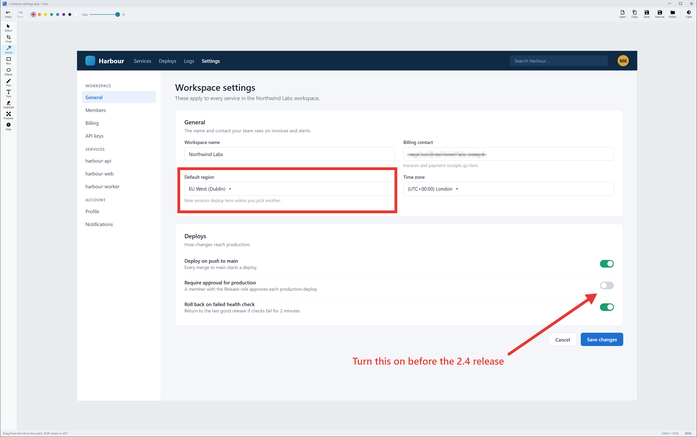
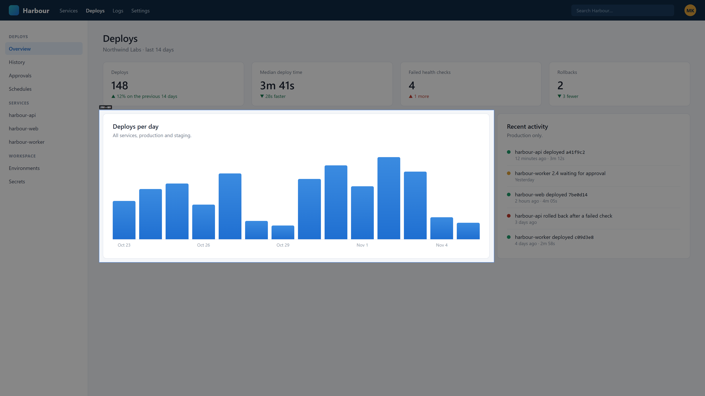
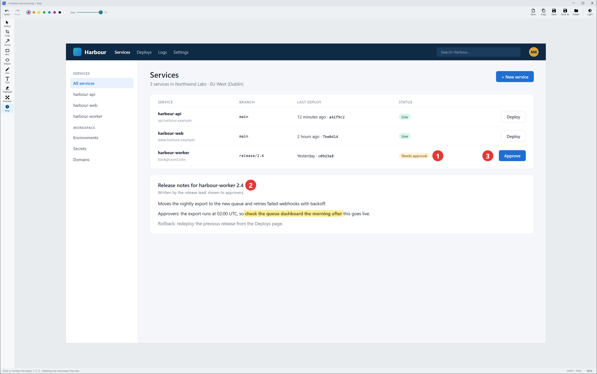

<h1 align="center">
  <picture>
    <source media="(prefers-color-scheme: dark)" srcset="design/logo/snip-logo-dark.svg">
    
  </picture>
</h1>

<p align="center">
  A screenshot tool for Windows, with an editor worth using.<br>
  <a href="https://snip.e-path.co.uk"><b>snip.e-path.co.uk</b></a> ·
  <a href="https://github.com/paulepath/snip/releases/latest/download/SnipApp-win-Setup.exe">Download for Windows</a> ·
  Made by <a href="https://www.e-path.co.uk">E-Path</a>
</p>



Print Screen, drag a region, mark it up, copy. The editor has arrows, boxes, ellipses, a pen, text, a highlighter,
pixelate and numbered steps, with crop, undo and Copy. It looks like [Total Git](https://totalgit.e-path.co.uk) and
[Panehouse](https://panehouse.e-path.co.uk) (Avalonia, the same palette), and began as the Pi Dash's screenshot editor.

## Features

- **Print Screen** freezes the screen. Drag a region, click a window, or press Enter for the whole monitor (Esc gives
  up). The shot is saved to `Pictures\Snip`, put on the clipboard and opened in the editor.
- **The Pi Dash:** while the PC's mouse is on the dash (Win+Esc in Pi Dash), Print Screen gives a shot of the dash
  instead (docs/pidash.md).
- **The editor:** marks can go past the picture's edge, and Copy then gives them on white. Closing asks only if there
  are marks not yet copied or saved. Tools, keys and the design are in docs/design.md.
- **The tray icon:** a click captures a region. The menu has the whole screen, Open, Paste, the shots folder, the Pi
  Dash switch and Start with Windows.

| Drag a region on the frozen screen | Numbered steps and the highlighter |
|---|---|
|  |  |

## Install

Run `SnipApp-win-Setup.exe` from the latest [release](https://github.com/paulepath/snip/releases/latest). It installs
to `%LOCALAPPDATA%\SnipApp`, starts Snip, starts it at sign-in, and Snip updates itself from then on. Settings > Apps
uninstalls it. Or:

```powershell
pwsh tools/install.ps1                      # download and run the latest Setup.exe (removes a -Dev copy first)
pwsh tools/install.ps1 -Dev                 # build this checkout, install to %LOCALAPPDATA%\Snip\app, start it
pwsh tools/install.ps1 -RestorePrintScreen  # give Print Screen back to Windows
```

The installer turns off Windows' own "Use the Print screen key to open screen capture", so Snip can have the key. The
tray says "Print Screen: taken by Windows or another app" if it couldn't. If that happens, turn the setting off in
Settings > Accessibility > Keyboard, then Exit and start Snip again. The log is `%LOCALAPPDATA%\Snip\snip.log`.

`Snip.exe <picture>` opens a picture; `--capture` acts as Print Screen; `--show` opens an empty editor; `--quit` ends
it (exit code 2 if a picture has unsaved marks). One Snip runs per user, and later starts hand over to it.

## Build and test

```powershell
dotnet build Snip.slnx
dotnet test Snip.slnx
```

- `src/Snip.Core`: the model, no UI (document, marks, undo, pixelate, capture geometry, settings, the pipe).
- `src/Snip`: the app (editor, capture overlay, tray, Print Screen, the Pi Dash link).
- `tests/Snip.Tests`: the tests.
- `tools/make-icon.ps1` draws `src/Snip/Assets/snip.ico`.
